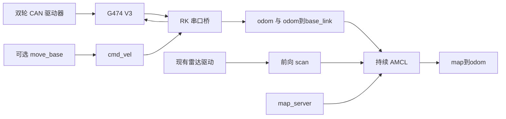

# 联通机器人 V3：G474 底盘与持续 AMCL

独立重写的 STM32G474 固件、RK ROS1 Noetic 串口桥、雷达适配与持续 AMCL。原讨论称其为“树莓派式 v11”；本仓统一称 **V3**，与既有 V11/V12 二进制版本区分。

本版本仅完成离线开发与验证，未烧录、未部署到 RK、未做实机测试。源码保存在新目录，不覆盖现用联通程序。构建证据和限制见 [验证记录](docs/VALIDATION.md)。

## 实现范围

- MCU：`CMD,v,w` 即时差速控制，STOP/ESTOP 锁存、RESUME/START 清锁，510 ms 命令超时停车，真实 CAN 轮速里程计，RS485 单请求单应答。
- RK：唯一串口 owner，默认只查询；有效新样本才更新 `/odom` 和 `odom→base_link`，按真实 MCU 采样 tick 映射时间，不延用旧速度制造新里程计。
- 雷达：对已有 `/lidar1/laser_fan` 做前 180° 裁剪，保留首束测量时刻；安装外参可配置，默认距离下限 1 m。
- 定位：`map_server` 和 AMCL 持续运行，AMCL 独占 `map→odom`；RViz `/initialpose` 不清 MCU 里程计。
- 可选导航：标准 GlobalPlanner + DWA 的 `move_base` 配置，接 `/cmd_vel`；需显式启用运动转发，不带原网页、动作队列或自写绕行器。



## 目录与使用

| 目录 | 内容 |
| --- | --- |
| `mcu/` | 控制、CAN 驱动、文本协议、G474 板级代码及生产 C 离线测试 |
| `rk/catkin_ws/src/liantong_v3/` | ROS Python 节点、catkin 包、launch、配置和离线测试 |
| `docs/PROTOCOL.md` | 双端共享协议、源时间与 ACK 含义 |
| `docs/BEHAVIOR_CHANGES.md` | 相对树莓派附件和联通 V12 的逐项变化 |
| `docs/CALIBRATION.md` | 轮径、轮距、雷达外参、时间与地图标定方法 |

[MCU 构建说明](mcu/README.md)和 [RK 安装与启动说明](rk/README.md)分别给出完整步骤。RK 使用独立 catkin 工作空间；地图 YAML/图像与雷达驱动由现场提供，不随仓库上传。V3 文本固件和 V3 ROS 桥必须配套，旧二进制客户端不能混用。

默认启动入口是 `localization.launch`，只发 QUERY，不发送速度或停止/恢复命令。可选 `navigation.launch` 使用同一定位链，默认也关闭运动；`enable_motion:=true` 才转发 `/cmd_vel`。本文的启动说明是后续部署方法，本次未在实车执行。

## 离线验证

在仓库根目录，用现有 ARM GCC 与 STM32Cube G4 SDK 编译；Windows 默认工具路径见 `mcu/build.py`，可用参数覆盖。

```text
python -B mcu/build.py --host-tests --firmware --name offline-final
python -B scripts/check_offline.py --mcu-receipt build/offline-final/receipt.json
```

第一步编译真实 C 控制/驱动/协议测试和 32 KiB G474 镜像；第二步运行 RK 生产核心测试，用 C 格式化器输出直接检查 Python 解码和时间处理，并检查 Python 3.8 语法与 launch XML。生成的固件、构建日志和收据都留在忽略的 `build/`，脚本没有烧录或连接实车入口。

## 已知边界

- 轮径 0.20 m、轮距 0.30 m 是标称值；雷达外参和 AMCL/DWA 参数需按标定文档验证。
- CMD 分量 ±1 的边界继承参考协议，不是现场推荐速度。驱动目标单位保持整数 RPM，不改其持久分辨率设置。
- ACK 只证明命令解析，不能证明停车。软件无法在 CAN 物理中断时保证停车命令送达；bus-off 需排除故障后重新启动 MCU。
- 显式 STOP 需 RESUME；普通命令超时可由新 CMD 恢复。驱动故障清旧目标。MCU 重启/里程计断段会结束当前 ROS 定位会话，需重新启动定位及输入初始位姿。
- 没有 V12 队列、续约、二进制 CRC/应答身份或 UART 永久故障锁存；没有额外配置 MCU IWDG。驱动器原有硬件参数未改，也未在本轮重新核实。
- 默认前 180° 和 1 m 下限保留现有覆盖限制。AMCL 只定位，不承担停车逻辑。真实 ROS 启动、硬件时序、停车性能和导航精度未验收。

来源见 [NOTICE](NOTICE.md)。
